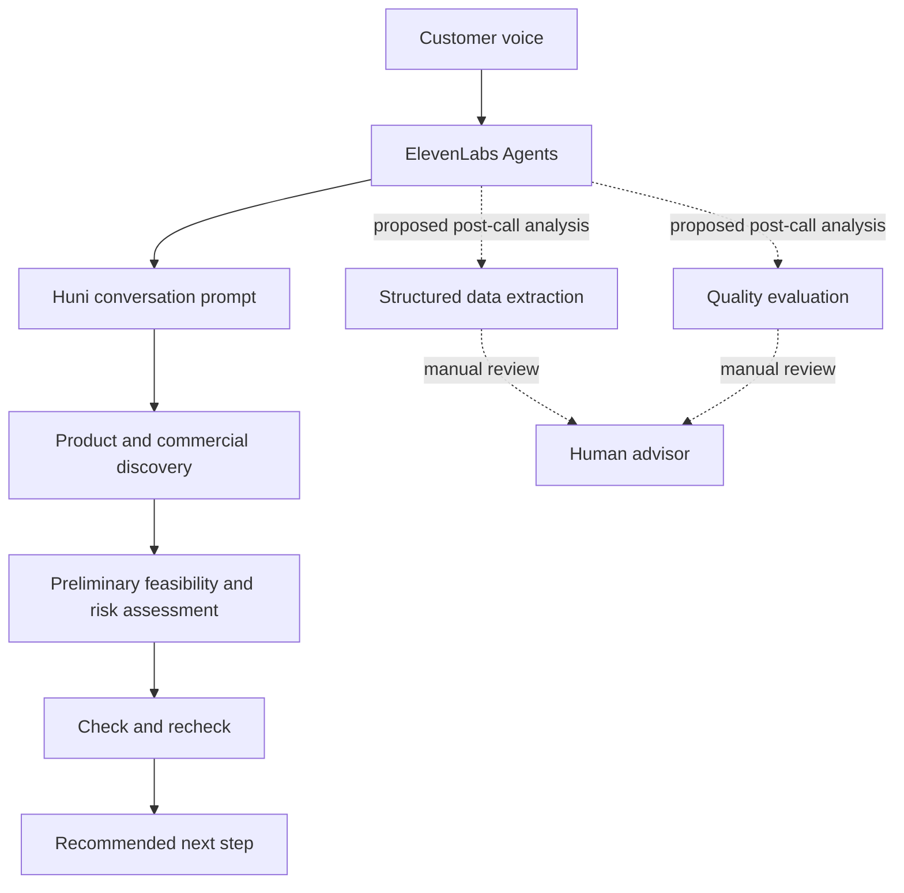

# Huni Voice — AI Trade Advisor

**From conversation to actionable business information.**

Huni Voice is a standalone voice AI prototype built around ElevenLabs Agents for international trade customer onboarding. It extends the concept behind Huni, Hunitro's conversational trade operations assistant, to natural voice interactions.

## Problem

SMEs often need to navigate unfamiliar documentation, regulations and operational decisions before they can assess an import or export opportunity. Repetitive discovery conversations and complex forms create friction for both customers and advisors.

## Approach

- Listen to the customer's objective and collect relevant information one question at a time.
- Identify missing information and potential risks without inventing regulatory or cost details.
- Confirm the conversation summary with the customer and recommend a next step.
- Use proposed post-call data extraction and evaluation criteria to support structured diagnostics and quality monitoring.

## Architecture

## Repository guide

| Resource | Purpose |
| --- | --- |
| [System prompt](prompts/system_prompt.md) | Conversational behavior and operational guardrails |
| [First message](prompts/first_message.md) | Spanish greeting |
| [Agent settings](config/agent_settings.json) | Reference settings and limitations |
| [Data collection](config/data_collection.json) | Proposed post-call extraction fields |
| [Evaluation criteria](config/evaluation_criteria.json) | Proposed quality criteria |
| [Architecture](docs/architecture.md) | Components, boundaries and data flow |
| [Adoption strategy](docs/adoption_strategy.md) | Pilot, metrics and scaling plan |
| [Test cases](tests/test_cases.md) | Five synthetic scenarios and safety checks |
| [Test results](tests/results.md) | Pending test log, not measured outcomes |
| [Demo assets](assets/README.md) | Guidance for publishing a sanitized demo |

## Reproduce the prototype

1. Create an agent in ElevenLabs Agents and select Spanish as the default language; optionally enable English.
2. Paste the system prompt and greeting from this repository.
3. Choose an available voice and model; review current plan limits and privacy settings before testing.
4. Manually configure post-call data collection and evaluation using the reference JSON files. These are descriptive, not vendor API exports or guaranteed importable schemas.
5. Run the synthetic scenarios in the test plan, record actual observations, and review the outputs before drawing conclusions.

## Status and limitations

Prototype configuration documented; this repository does not independently verify deployment, live data extraction, completed evaluations, or measured outcomes. No real customer records, API credentials, production integrations, or live trade data are included. The agent does not execute external actions or provide definitive customs, legal or tax advice. The proposed three-minute limit and analytics settings must be checked in the live console.

## Author

Ignacio Imperatrice — industrial engineer, technology entrepreneur and business development professional. This portfolio project explores voice AI, business process engineering and customer adoption. Built using ElevenLabs Agents; not affiliated with or endorsed by ElevenLabs.
